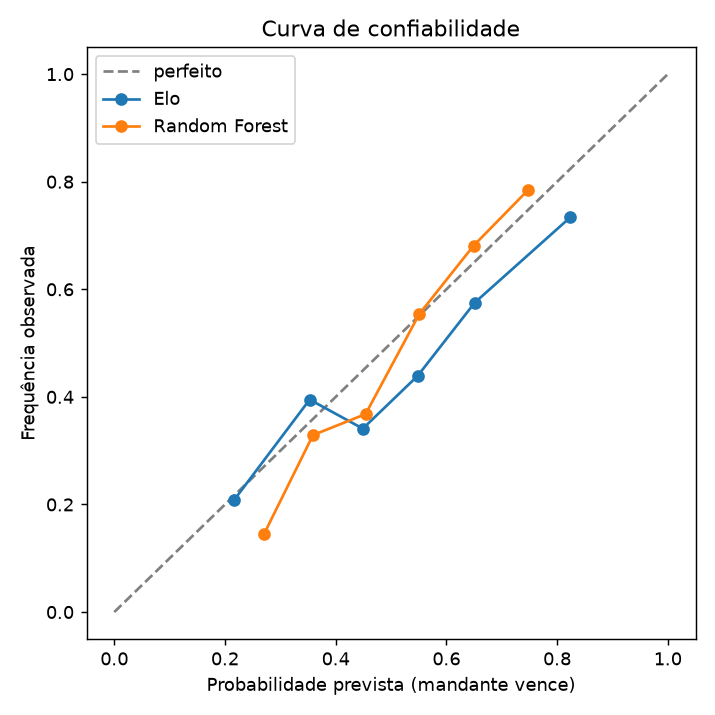

# Previsão de partidas da NBA: Elo × Random Forest

Projeto que compara dois modelos para prever a probabilidade de o **mandante vencer** uma partida da NBA:

1. **Elo** – sistema de rating simples, sem machine learning, com multiplicador por margem de pontos, vantagem de jogar em casa e regressão à média a cada temporada.
2. **Random Forest** – treinado com a forma recente dos times (médias móveis dos jogos anteriores) e as diferenças entre mandante e visitante.

Os dados vêm da [`nba_api`](https://github.com/swar/nba_api) (endpoint `LeagueGameFinder`), temporada regular de **2020-21 a 2024-25** (6.000 jogos).

## Resultados (teste em 2024-25, 1.230 jogos)

| Modelo | Acurácia | Log loss | Brier |
|---|---|---|---|
| Baseline (sempre a taxa do mandante) | 54,4% | 0,690 | 0,248 |
| Elo | 65,7% | 0,627 | 0,218 |
| Random Forest (janela de 20 jogos) | 66,4% | 0,626 | 0,218 |

- Os dois modelos concordam sobre o vencedor em 85% dos jogos. Quando discordam (185 jogos), o RF acerta 52,4% e o Elo 47,6%.
- **A diferença entre eles não é estatisticamente relevante**: a diferença de acurácia (+0,7 p.p.) tem intervalo de confiança bootstrap de aproximadamente −1,5 a +3,0 p.p., e o log loss é praticamente idêntico. O resultado honesto é um empate técnico: um Elo simples já captura quase tudo que o RF extrai das estatísticas de caixa.
- Calibração (`confiabilidade.png`): o Elo é **superconfiante** nas probabilidades altas (prevê ~82%, acontece ~73%). O RF fica mais próximo da diagonal, mas é conservador nos extremos.



## Metodologia (sem vazamento de dados)

- **Divisão temporal**: treino em 2020-21 a 2023-24, teste em 2024-25. Nada de split aleatório.
- **Features do RF**: médias dos `N` jogos *anteriores* (`shift(1)` antes do `rolling`) de PTS, FG%, 3PA, 3P%, REB, AST, STL, BLK, TOV e pontos sofridos, para mandante, visitante e a diferença entre eles. O Elo **não** entra nas features, para que os modelos sejam independentes.
- **Escolha da janela `N`** (3, 5, 10, 15 ou 20): validada em 2023-24, treinando só nas temporadas anteriores. A temporada de teste não é usada nessa escolha. Foi escolhida `N = 20`.
- **Elo**: o rating "pré-jogo" é registrado antes da atualização. Parâmetros: `K = 20`, vantagem de casa = 100, rating inicial = 1500, regressão de 25% à média entre temporadas.
- **Mandante**: identificado pela sigla no campo `MATCHUP` (`"A vs. B"` → A; `"A @ B"` → B). Jogos inconsistentes (sem 2 times e exatamente 1 mandante) são descartados; nenhum foi encontrado nesses dados.
- **Métricas**: acurácia, log loss, Brier, tabela/curva de confiabilidade, acerto por faixa de confiança e concordância entre os modelos.

## Estrutura do projeto

```
.
├── main.py                      # coleta dos dados na nba_api
├── previsao.py                  # Elo, Random Forest, avaliação e previsão de confrontos
├── confiabilidade.png           # gráfico gerado por previsao.py
├── README.md
└── dados/
    ├── dados_treinamento.csv    # dados brutos (uma linha por time por jogo)
    └── requirements.txt         # dependências
```

| Arquivo | Função |
|---|---|
| `main.py` | Coleta as temporadas 2020-21 a 2024-25 na `nba_api` e gera `dados/dados_treinamento.csv`. Só é necessário para refazer ou atualizar os dados |
| `previsao.py` | **Script principal**: Elo, Random Forest, escolha da janela, avaliação comparativa, gráfico e previsão interativa de confrontos. Lê apenas `dados/dados_treinamento.csv` |
| `dados/dados_treinamento.csv` | Dados brutos usados pelos dois modelos |
| `confiabilidade.png` | Curva de confiabilidade, regenerada a cada execução do `previsao.py` |
| `dados/requirements.txt` | Dependências do projeto |

## Como executar

```bash
pip install -r dados/requirements.txt

# 1. (opcional) refazer a coleta de dados – precisa de internet
python main.py

# 2. Avaliar os modelos e prever confrontos
python previsao.py
```

O `previsao.py` imprime a escolha da janela, a avaliação em 2024-25 e salva `confiabilidade.png`. Em seguida pede as siglas dos times (ex.: `BOS`, `LAL`) e mostra a probabilidade de cada modelo e a média dos dois.

## Limitações

- Os dados terminam em **13/04/2025**. As previsões usam a forma e o Elo do fim de 2024-25, e a regressão à média da virada de temporada não é aplicada para temporadas posteriores. Para uso atual, é preciso incluir a temporada mais recente em `main.py`.
- Não considera lesões, escalações, back-to-backs nem viagens. O RF usa apenas estatísticas agregadas do time.
- O RF usa hiperparâmetros fixos (`n_estimators=300`, `max_depth=6`, `min_samples_leaf=10`) e o Elo não foi ajustado (`K`, vantagem de casa). Ambos poderiam ser otimizados com validação temporal.
- Uma única temporada de teste (1.230 jogos) dá pouca precisão: diferenças de ~1 p.p. entre modelos são ruído.
- Os valores acima são de um único teste e podem variar se os dados forem recoletados.
